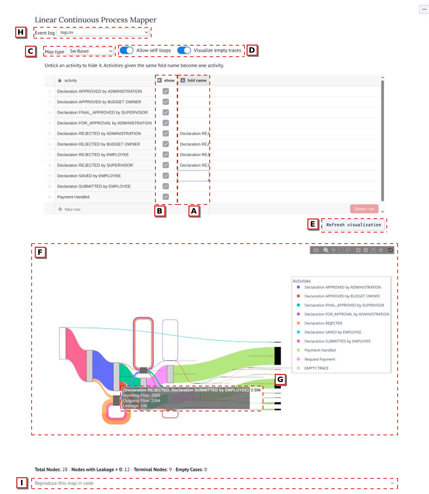

# LCM Marimo

# Linear Continuous Process Mapper

A prototypical implementation of linear and continuous process maps for the exploratory analysis of sequential behavior in event logs. This Python application builds upon interactive Sankey diagrams to provide effective visualizations of process behavior. The system loads event logs, constructs process maps using different abstractions (such as sequence-based, set-based, and last-activity-based), and visualizes them to display relevant insights in a precise yet interpretable way.

## Overview

UI of the application. Users choose an event log from the `logs/` folder via the event log selector (H), and can either analyze it as-is or apply further transformations by editing the marimo notebook. In the activity table, they can untick activities to hide them (B) and fold activities by giving them the same fold name (A). Furthermore, users can select from the three generic LCMs: sequence-, set-, or last-activity abstraction (C) and choose whether to visualize self-loops and empty traces (D). After selecting the desired visualization controls, they can refresh the visualization (E), which refreshes the Sankey diagram (F). Here, they can freely reposition nodes to adjust the visualization to their needs. More details about edges and nodes are revealed on hover (G). The current settings are also available as a `generate` call to copy into a notebook cell (I).

## How to Run

This is the marimo version of the LCPM.

To get started:

```
uv sync
``` 

Then to run:
```
uv run marimo run marimo_app.py
```

Or to edit;
```
uv run marimo edit marimo_app.py
```

### Event logs

Put event logs in the `logs/` folder and choose one from the **Event log** dropdown at the top of the app. Both `.xes` and `.csv` files are supported. A CSV needs these columns:

- `case:concept:name`: case ID
- `concept:name`: activity
- `time:timestamp`: timestamp

The included `logs/log.csv` is a preprocessed version of DomesticDeclarations2H.xes, converted from XES to CSV with only the case, activity, and timestamp columns kept.

## Programmatic Use

The widgets in `marimo_app.py` are one way to call the `lcm` library. The same maps can be drawn from code, without any widgets. To fix a state you found interactively, copy the call from **Reproduce this map in code** below the map.

```python
import lcm

lcm_service = lcm.get_service(lcm.load_event_log("logs/log.csv"))

figure, metadata = lcm_service.generate(
    activities=None,  # None keeps all of them; folded ones go by their fold name
    map_type=lcm.MapType.SEQUENCE_BASED,  # or "sequence_based"
    allow_loops=True,  # has no effect on sequence-based maps
    visualize_empty_cases=True,
    folds={"Rejections": ["Declaration REJECTED by ADMINISTRATION", "Declaration REJECTED by SUPERVISOR"]},
)
```

All arguments are optional and invalid choices raise a `ValueError`. `figure` is a Plotly figure and `metadata` is a dict of counts. `generate` starts from the full log on every call, so one service can draw many maps. In a marimo notebook, every cell needs its own variable names:

```python
# One cell
set_map, set_metadata = lcm_service.generate(map_type="set_based")
set_map
```

```python
# Another cell
last_activity_map, last_activity_metadata = lcm_service.generate(map_type="last_activity_based")
last_activity_map
```

Display the figure directly. Wrapping it in `mo.ui.plotly()` leaves a blank plot, because that wrapper does not support Sankey traces.

## Project Structure


**marimo_app.py** - The main entry point for running the application, via a marimo notebook. It is also the example of
interactive use of the library.

**lcm** - The library, independent of marimo. `lcm/__init__.py` wires together all components (data processors, graph
builders, analyzers) in `get_service`. It contains the main analytical components:

- **data** - Event log data handling using PM4Py. Loads XES and CSV files, orders each case's events by timestamp,
  applies folds, filters by activities, and creates the variants for analysis
- **domain** - Graph analysis algorithms that enrich process graphs with business metrics including flow analysis,
  leakage detection, termination ratios, and node balancing
- **graph_builders** - Multiple strategies for constructing process graphs from event data: set-based prefix graphs,
  sequence-based prefix trees, and last-activity-based graphs with configurable loop handling
- **services** - High-level orchestration services that coordinate graph construction and the complete analytics
  pipeline from raw data to visualizations
- **visualization** - Interactive Sankey diagram generator using Plotly that converts enriched process graphs into
  color-coded flow visualizations with hover details and activity legends

**tests** - Tests of the library. Run them with `uv run pytest`.

## Repository Authors
- [@moritzfaes](https://github.com/moritzfaes)
- [@hvoelzer](https://github.com/hvoelzer)
- [@aaronkurz](https://github.com/aaronkurz)
